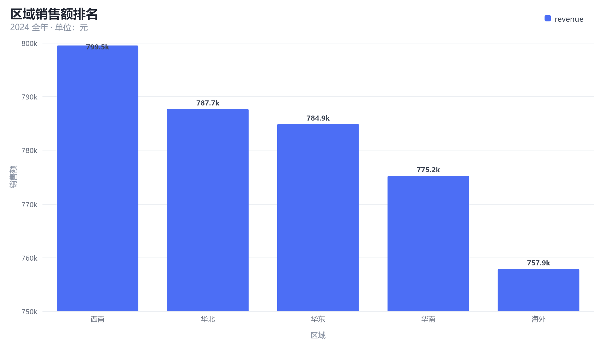
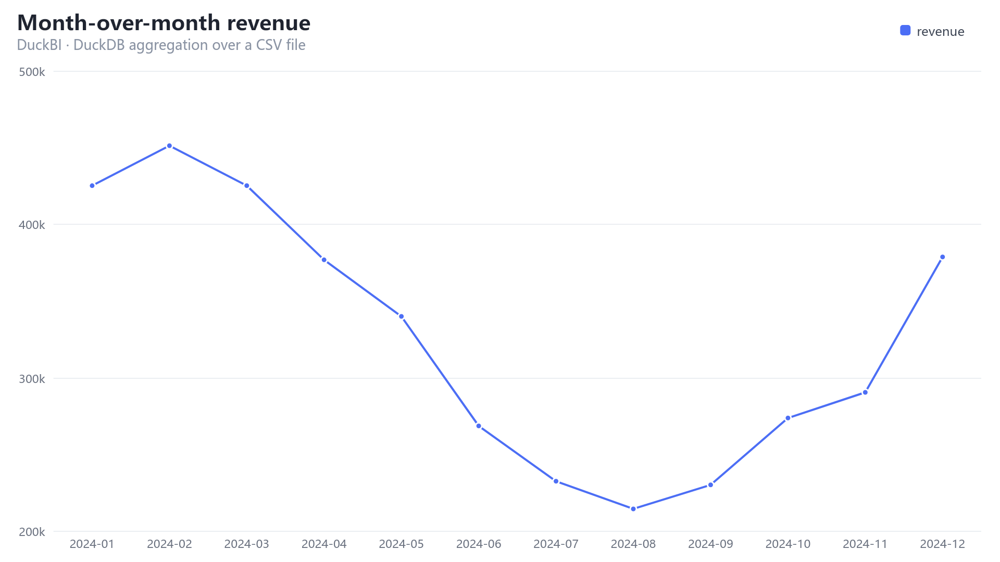

# DuckBI · 让 AI 直接分析你电脑里的 Excel 和日志

**中文** | [English](README.en.md)

> **本地 DuckDB 引擎 · 对话式取数 · 一键出图出报表**
> 
> 不用上传文件、不用建仓库、不用学 BI 工具 —— 指一个目录，然后开始聊天。


**前置条件**

> **你需要先安装 DeepSeek Harness desktop，然后才能使用本项目的所有功能**
> 
> 本项目是一个dsh插件，核心用duckdb引擎做的，不建议单独运行。如果感兴趣，您可以尝试在codex, claude或者任何其他的code agent产品中安装，但是不保证使用效果。

`#dsh-plugin` · `DuckDB` · `local-first` · `Excel / Log / CSV / JSON` · `MIT`

[](https://github.com/don2ccc/DuckBI-DSH/actions/workflows/ci.yml)
[](https://github.com/don2ccc/DuckBI-DSH/actions/workflows/release-asset.yml)



---

## 30 秒看懂

|  | 传统做法 | DuckBI |
| --- | --- | --- |
| 数据怎么进来 | 手动上传到 SaaS / 建数仓 / 写 ETL | **指一个文件夹，自动建表** |
| 怎么取数 | 拖拽维度、写 DAX、找人提需求 | **说一句话，AI 写 SQL** |
| 大文件 | 网页传不动、Excel 打不开 | **1.3 GB 日志 9 秒入库，370 万行秒级聚合** |
| 报表 | 模板工具里拼 | **一次生成多节报告：KPI 卡 + 表 + 图 + 结论** |
| 数据边界 | 全量上传云 | **原始文件永不外发；计算全在本机** |

**它不是一个"上传文件给 AI 看"的工具，而是一个装在你机器上的分析引擎，AI 只负责下命令。**

---

## 三步装好（约 2 分钟）

前提：装了 DeepSeek Harness（桌面版或 `dsh` CLI），且**至少启动过一次**（这样 profile 已存在）。

```powershell
git clone https://github.com/don2ccc/DuckBI-DSH.git
cd DuckBI-DSH\packages\dsh-plugin-duckbi
npm install
node install.mjs
```

装完确认一眼：

```powershell
Get-Content "$env:USERPROFILE\.dsh\duckbi\plugin-loaded.json"
```

看到 `"ok": true` 就装好了 → **重启一次 Harness**（首次加载需要）→ 在对话里说：

> 把 `D:\数据\销售` 加进来，看看有哪些数据

> 没装 git？用「Code → Download ZIP」解压后从 `cd` 那步继续。
> 换 profile、离线、手动安装、排错见下面的 [安装详解](#安装详解)。

---

## 它能做什么

### ① 指个目录，就变成数据库

```
你：把 D:\data\销售 加进来
AI：→ 扫描 13 个文件 → 建了 3 张表（1,099,083 行），9.4 秒
```

支持 `.log` `.csv` `.tsv` `.json` `.jsonl` `.ndjson` `.parquet` `.xlsx` `.xlsm`，
压缩包（`.gz` / `.zst`）直接读，**GB18030 中文编码自动识别转码**，
Excel 多个工作表自动拆成多张表，**中文表头原样保留**。也可以直接指**单个文件**，
插件会只登记它、不扫描整个目录。

### ② 聊天就是 SQL 编辑器

```
你：North 区各产品月度退货率
AI：（发现每个格子只有 1–3 单 → 主动降维到半年口径重算，并告诉你为什么）
```

模型会**先看表结构再写 SQL**，跑完看结果，不对就改。你可以只聊业务，不说 SQL。

### ③ 图直接在对话里显示



柱状、折线、面积、环形、散点，服务端用 Canvas 渲染成 PNG，**有附件服务时直接内嵌在聊天里**。
中文标题、千分位刻度、自动折叠 `Other` 都处理好了。

### ④ 报表一句话落地

```
你：按这个口径做份报表，我要给总监汇报
AI：→ 一次生成多节 PDF + 同口径 Excel：KPI 卡 / 区域积分卡 / 同期增长 / 交叉表 / 图表 / 结论
```

给 `duckbi_export` 传 `sections` 就能一次调用产出**多节 PDF + 多工作表 Excel**：`kpi` 画成指标卡，
`table` 出格式化表格，`chart` 把图直接嵌进 PDF，`text` 写结论。图表只渲染一次、PDF 与 Excel 共用同一批 SQL，
不用为每一节再往返一次模型。版式定下来后可以**固化成模板**，之后 `node scripts/report.mjs <源文件>`
一条命令重跑，不经过模型、0 token，适合日报/周报。

Excel 带表头样式、冻结窗格、筛选、数字格式、生成信息页；PDF 是 A4 横向、跨页重复表头、页码、
**中文字体内嵌**，图表会按页面宽度自动缩放、避免标题与图分页。

### ⑤ 为对话省 token

- **工具描述压缩**：5 个工具的描述常驻每次请求，控制在约 2.5 KB。
- **扫描/目录默认只回摘要**：几十上百个文件不会把"每文件一行"的表灌进上下文；需要时再 `detail: true`。
- **schema 搜索**：`duckbi_schema { query: "orders" }` 命中一张表时直接返回列信息，省掉一次往返。
- **报表一次调用**：多节报告只占一次工具往返，而不是"画图 + 导出"各来一遍。

---

## 数据到底去了哪儿（重要，请读完）

**没有任何文件被上传。** 具体边界如下：

| 环节 | 在哪执行 | 会离开你的机器吗 |
| --- | --- | --- |
| 读 Excel / 日志、建表、SQL 聚合 | 本机 DuckDB（嵌入式，无服务、无端口） | **不会** |
| 图表渲染、Excel / PDF 生成 | 本机 Node.js | **不会** |
| 原始文件内容 | —— | **永不外发** |
| 列名、表结构、查询**结果表**（默认 ≤ 200 行） | 随对话发给模型 | 云端模型：会 |
| 你打的字、模型写的 SQL | 随对话发给模型 | 云端模型：会 |

也就是说：**能本地算的绝不外发**，模型只看到"你允许它看到的聚合结果"，看不到你的原始文件。

### 想要绝对零外发？换成本地模型即可

Harness 支持任意 OpenAI 兼容端点。把它指向你局域网里的推理服务（Ollama / vLLM / LM Studio 都行），
再配合本插件，**整条链路——数据、计算、模型推理——全部不出机器**：

```yaml
# cordis.patch.yml
- id: llm-pi-ai
  name: '@deepseek-ai/dsh-llm-pi-ai'
  config:
    providers:
      local:
        api: openai-completions
        baseURL: http://127.0.0.1:11434/v1   # 你的本地推理服务
        apiKeyEnv: LOCAL_LLM_KEY
        models: [{ id: qwen2.5-coder:14b, name: Qwen2.5 Coder 14B }]
```

再把 `maxRows` 调小、只让模型看聚合结果（`GROUP BY` 之后再问），外发面就趋近于零。

---

## 安装详解

安装 = **把包放进 profile 能解析的位置** + **在 profile 的补丁文件里加一条 insert**。
仓库自带 `install.mjs` 把这两步做完，也可以手动做（见下文，脚本只做这两件事，不碰别的）。

### 0. 前置条件

| 要求 | 怎么确认 | 说明 |
| --- | --- | --- |
| DeepSeek Harness | 桌面版能打开，或 `dsh --version` 有输出 | 桌面版与 CLI 都可以 |
| Node.js 20+ | `node -v` | **只用于安装与跑脚本**；插件运行时用的是 Harness 自带的 Node |
| 至少一个 profile | `dir %USERPROFILE%\.dsh\profiles`（macOS/Linux：`ls ~/.dsh/profiles`） | 没看到 `desktop` 就先启动一次桌面版，或改用 `--profile web` |

> `DSH_HOME` 默认是 `%USERPROFILE%\.dsh`（macOS/Linux 是 `~/.dsh`）。装在别处的话所有命令加 `--home <你的路径>`。

### 方式 A：git clone（推荐）

```powershell
git clone https://github.com/don2ccc/DuckBI-DSH.git
cd DuckBI-DSH\packages\dsh-plugin-duckbi
npm install            # 按你的平台拉原生二进制（约 130 MB，首次约 10 秒）
node install.mjs       # 默认装到 desktop profile
```

要装到别的 profile、或顺便预登记数据目录：

```powershell
node install.mjs --profile web
node install.mjs --sources D:\日志,D:\台账 --warmup eager
```

### 方式 B：下载 ZIP（没有 git）

1. 仓库页 → **Code → Download ZIP** → 解压，例如 `D:\DuckBI-DSH-main`
2. 然后同方式 A：

```powershell
cd D:\DuckBI-DSH-main\packages\dsh-plugin-duckbi
npm install
node install.mjs
```

### 方式 C：一行命令装发布包（最快）

```powershell
# 1) 直接把 GitHub Release 的包装进 profile（依赖随之安装；pnpm 会解析这个 tarball URL）
dsh plugin --profile desktop add https://github.com/don2ccc/DuckBI-DSH/releases/download/v0.2.0/duckbi-dsh-plugin-duckbi-0.2.0.tgz

# 2) 再写配置（包已在 node_modules 里，用 --no-link 跳过软链）
node "$env:USERPROFILE\.dsh\profiles\desktop\node_modules\@duckbi\dsh-plugin-duckbi\install.mjs" --no-link
```

也可以先用浏览器下载 [Releases 里的 `.tgz`](https://github.com/don2ccc/DuckBI-DSH/releases/tag/v0.2.0)，
或者拿同事发你的包，把第一步换成本地路径：

```powershell
dsh plugin --profile desktop add .\duckbi-dsh-plugin-duckbi-0.2.0.tgz
```

自己打包给同事：

```powershell
cd packages\dsh-plugin-duckbi
npm pack          # -> duckbi-dsh-plugin-duckbi-0.2.0.tgz（约 80 KB，不含 node_modules）
```

> **不要把 `node_modules` 拷给别人。** `@duckdb/node-api` 和 `@napi-rs/canvas` 带平台原生二进制，
> Windows 的 `.node` 文件在 macOS/Linux 上会直接加载失败。让对方自己 `npm install`。

### 安装器到底做了什么（可以逐条核对）

1. 把包链接到 `<home>/profiles/node_modules/@duckbi/dsh-plugin-duckbi`
   （Windows 用 junction，macOS/Linux 用 symlink）——**不复制 `node_modules`**；
2. 往 `<home>/profiles/<profile>/cordis.patch.yml` 追一段带标记的配置：

   ```yaml
   # >>> DuckBI (managed by install.mjs) >>>
   - insert:
       - id: duckbi
         name: '@duckbi/dsh-plugin-duckbi'
         config:
           dataDir: 'C:\Users\me\.dsh\duckbi'
           warmup: lazy
           sources: []
   # <<< DuckBI (managed by install.mjs) <<<
   ```

   **你原有的配置一行都不动**；重复安装会原地替换这一段（不会写出两份）；
   如果 profile 还是空层 `[]`，安装器会把 `[]` 换掉而不是傻追加（否则 YAML 非法）。
3. 创建数据目录 `<home>/duckbi`（DuckDB 文件、导出文件、临时转码副本都在这）。

除此之外不改任何东西，不需要管理员权限。

### 手动安装（不想跑脚本）

```powershell
# 1) 建目录并链接（Windows；macOS/Linux 用 ln -s）
New-Item -ItemType Directory -Force "$env:USERPROFILE\.dsh\profiles\node_modules\@duckbi"
New-Item -ItemType Junction `
  -Path "$env:USERPROFILE\.dsh\profiles\node_modules\@duckbi\dsh-plugin-duckbi" `
  -Target "D:\DuckBI-DSH\packages\dsh-plugin-duckbi"
```

```bash
# macOS / Linux
mkdir -p ~/.dsh/profiles/node_modules/@duckbi
ln -s /path/to/DuckBI-DSH/packages/dsh-plugin-duckbi ~/.dsh/profiles/node_modules/@duckbi/dsh-plugin-duckbi
```

然后在 `~/.dsh/profiles/desktop/cordis.patch.yml` **末尾**追加（若文件只有 `[]`，请把 `[]` 删掉）：

```yaml
- insert:
    - id: duckbi
      name: '@duckbi/dsh-plugin-duckbi'
      config:
        dataDir: 'C:\Users\me\.dsh\duckbi'   # 必须单引号，双引号会把 \U 当转义
        warmup: lazy
        sources: []
```

最后 `mkdir` 一下 `dataDir` 再启动 Harness。

### 验证装好了

```powershell
Get-Content "$env:USERPROFILE\.dsh\duckbi\plugin-loaded.json"
# macOS/Linux: cat ~/.dsh/duckbi/plugin-loaded.json
```

```json
{
  "plugin": "@duckbi/dsh-plugin-duckbi",
  "version": "0.2.0",
  "pid": 41008,
  "electron": "44.0.0",
  "duckdb": "v1.5.6",
  "ok": true
}
```

- **文件存在且 `ok: true`** → 插件已在你**正在运行的** Harness 进程里加载，并且成功跑过一次 DuckDB 查询。
- **文件不存在** → 插件没被加载，看下面的排错表。

### 排错

| 现象 | 原因 / 处理 |
| --- | --- |
| 对话里看不到 `duckbi_*` 工具 | **改过源码必须重启 Harness**（只改 `cordis.patch.yml` 会热加载，改代码不会）。先确认 `plugin-loaded.json` 存在 |
| `找不到 profile "desktop"` | 桌面版没启动过。启动一次，或用 `--profile web` 换成本机已有的 profile 名 |
| `npm install` 卡住 / 失败 | 原生包 `@duckdb/node-bindings-*`、`@napi-rs/canvas-*` 需要能下载；换网络或镜像后重试 |
| 第一次读 `.xlsx` 报 excel 扩展错误 | 需要**联网一次**自动安装 DuckDB `excel` 扩展；内网机器把 `~/.dsh/duckbi/extensions` 整个目录拷过去即可离线 |
| `another process is using it` | DuckDB 单写者：同一个数据目录同时只能有一个 Harness 在写 |
| 中文全是乱码 | GB18030 会自动转码；若仍乱码，确认不是 UTF-16 或已被其他工具二次编码 |
| 配置改了不生效 | `cordis.patch.yml` 被监听，通常几秒内热加载；不行就重启 |
| Windows 路径报 YAML 解析错 | 路径必须用**单引号**；双引号里 `\U`、`\.` 会被当转义 |

### 升级 / 卸载 / 多 profile

```powershell
# 升级（软链到仓库，所以代码是跟着 git 走的）
cd DuckBI-DSH; git pull
cd packages\dsh-plugin-duckbi; npm install; node install.mjs   # 幂等，原地替换配置块
# 然后重启 Harness

# 卸载
node install.mjs --remove        # 移除配置块与链接，保留 ~/.dsh/duckbi 数据

# 多 profile：每个 profile 各跑一次
node install.mjs --profile web
node install.mjs --profile headless
```

### 平台与配置

- **Windows x64 / macOS（Intel 与 Apple Silicon）/ Linux x64** 都有预编译原生包；其他架构需自行编译。
- 仓库里的 `install.mjs` 是**不带依赖**的纯 JS（只用 Node 内置模块），所以链接这一步不需要先 `npm install`；
  但插件运行时需要依赖，所以别跳过 `npm install`。

配置项（`dataDir` / `warmup` / `sources` / `maxRows` / `allowedRoots` / `allowWriteSql` …）与
完整说明见 [插件 README](packages/dsh-plugin-duckbi/README.md)。

---

## 真实对话片段

一次完整的多轮分析，原文见 [docs/examples/console.txt](docs/examples/console.txt)：

```
### 区域销售额排名            [duckbi_query]     9 ms
| region | orders | revenue | avg_order | share_pct |
| :---   |  ---:  |    ---: |      ---: |      ---: |
| 西南   |    295 | 799,501 |     2,710 |     20.47 |
…

### 数据体检                  [duckbi_query]
发现 5 个口径问题：Date 与 OrderDate 完全重复、StoreLocation 与 Region 逻辑矛盾、
FREESHIP 促销的运费没有归零、单价与商品无关、退货率 24.8% 且与任何维度无关。
```

**它不只出数，还会告诉你这批数据能不能用。**

---

## 为什么快

- **DuckDB 列存 + 向量化**：370 万行聚合是毫秒级（demo 里 9 ms）。
- **物化表，不是视图**：首次扫描有成本，之后每次查询都命中本地列存。
- **增量扫描**：按 `(大小, mtime)` 判断，改一个文件只重算一个文件；`stat` 并发探测，大目录不再逐个排队。
- **DuckDB 调优**：排序/哈希溢出落到本地 `temp` 目录，关闭对话无关的插入顺序保序和进度条。
- **报表可 0 token 重跑**：口径定下来后，`node scripts/report.mjs` 直接出 PDF，不经过模型。

---

## 它明确不做什么

- 不做数据可视化大屏、不做实时流、不做多租户 BI 平台。
- 不解析 `.xls`（老二进制格式）；不支持跨平台拷 `node_modules`（原生包与平台绑定）。
- 不是"把文件塞进上下文让模型读"——那是几万 token 起步且会算错；这里 SQL 在本地算。

---

## 项目结构

```
packages/dsh-plugin-duckbi/   插件本体（可分发的 npm 包，78 KB tarball）
  lib/                        engine / ingest / catalog / sql / chart / exporters / tools
  install.mjs                 自包含安装器（软链 + 写配置 + 卸载）
  test/                       64 项端到端断言 + 图表/导出冒烟测试
scripts/
  install.mjs                 仓库内安装入口（转发到包内安装器）
  demo.mjs                    造演示数据，跑通全流程，产出样例（含多节富报表）
  report.mjs                  报表模板：一条命令出 PDF + Excel
docs/
  architecture.zh.md          设计文档：摄入路径、并发模型、取舍
  examples/console.txt        真实对话输出
```

## 开发

```bash
cd packages/dsh-plugin-duckbi
npm install
node test/run-tests.mjs      # 64/64：真实 cordis + 真实工具管线 + 真实 DuckDB
node test/chart.smoke.mjs    # 图表 15 例
node test/export.smoke.mjs   # Excel/PDF 87 项断言
```

测试要跑真实的 `@deepseek-ai/cordis` 与工具运行时，它们作为 **devDependencies** 装在本地，
所以**不需要机器上预先装 Harness**（CI 就是这么跑的）。想改成测某个已安装的 profile，设
`DSH_HOME=<你的 Harness home>` 即可——解析顺序是「本地 `node_modules` → profile」。

> 插件**运行时**不 import 任何 `@deepseek-ai/*`，只用 `ctx.tools`；那些包只在测试里出现。

设计取舍、失败案例与限制见 [docs/architecture.zh.md](docs/architecture.zh.md)。

## 许可

MIT · 见 [LICENSE](LICENSE)。
